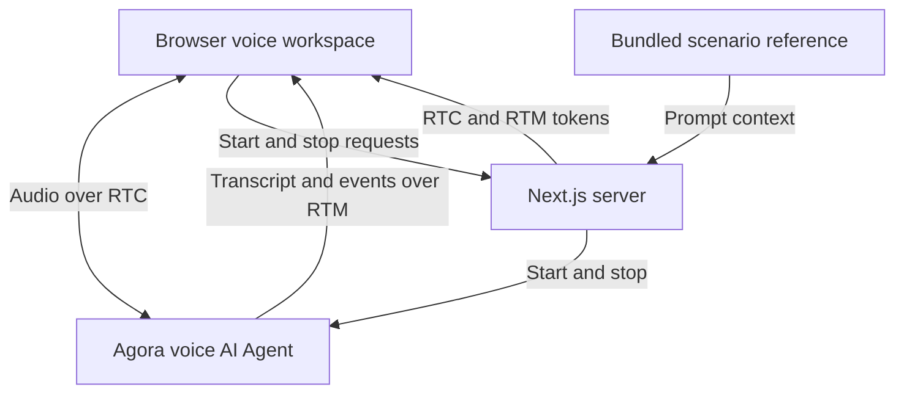

# Agora Course Consultation Assistant Demo

[English](README.md) | [简体中文](README.zh-CN.md) | [日本語](README.ja.md)

A voice AI course consultation demo built with Agora and Next.js. Discuss a fictional youth basketball trial, ask about a child's needs, and walk through a simulated enrollment.

**[Explore more voice AI demos on Agora Recipes →](https://recipes.agora.io/)**

[](https://www.agora.io/en/products/conversational-ai-engine/)
[](https://nextjs.org/docs)
[](LICENSE)

[Features](#features) · [Tech stack](#tech-stack) · [Run locally](#run-locally) · [Deploy to Vercel](#deploy-to-vercel) · [How it works](#how-it-works) · [Customize](#customize) · [FAQ](#faq) · [More](#more)

<!-- Recipes URL: add the published Agora Recipes page URL here. -->
<!-- Video placement: add a linked cover image here once the actual demo video is ready. Show a parent asking about a beginner trial, reviewing a future session and price, and choosing whether to simulate enrollment. Use a descriptive alt and public video URL. Verify playback or fallback links on GitHub and Recipes. -->

<a id="what-you-can-do"></a>

## Features

- **Trial introduction:** ask about the beginner lesson, price, venue, equipment, and preparation.
- **Parent questions:** discuss the child's age, experience, interests, and concerns about trying basketball.
- **Trial dates:** ask about upcoming weekend trial classes in the demo. All times use Austin local time.
- **Simulated enrollment:** recap the selected session and example fee before deciding whether to confirm.
- **Voice and transcript:** follow the consultation through audio and live text.

## Tech Stack

- **Frontend:** Next.js, React, TypeScript.
- **Voice AI:** Agora Conversational AI, Agents SDK, RTC and RTM.
- **Models:** Deepgram STT, OpenAI LLM, MiniMax TTS.

<a id="quick-start"></a>
<a id="run-it"></a>
<a id="try-it"></a>
<a id="conversation"></a>

## Getting Started

### Run Locally

You need Node.js 24, pnpm 9.15.9, and an [Agora project](https://console.agora.io/) with Conversational AI enabled.

**1. Install and configure**

Clone or download this repository, then open a terminal in its directory.

```bash
pnpm install --frozen-lockfile

if [ ! -f .env.local ]; then
  cp env.local.example .env.local
fi
```

Create or select a project in [Agora Console](https://console.agora.io/). Open **Manage credentials** and copy its **App ID** and **Primary certificate** into `.env.local` ([instructions](https://docs.agora.io/en/introduction/console-setup)):

```dotenv
NEXT_PUBLIC_AGORA_APP_ID=your_agora_app_id
NEXT_AGORA_APP_CERTIFICATE=your_agora_app_certificate
```

You don’t need separate API keys for the default speech and language models. Put the App Certificate in `.env.local` and never expose it in browser code.

See [env.local.example](env.local.example) for the configuration template.

**2. Start the app**

```bash
pnpm run doctor
pnpm run dev
```

Open [http://localhost:3000](http://localhost:3000), choose **Start course consultation**, and allow microphone access. Ask the assistant to summarize the conversation if needed, then click the hang-up button (**End session**).

<a id="deployment"></a>

### Deploy to Vercel

[](https://vercel.com/new/clone?repository-url=https%3A%2F%2Fgithub.com%2FAgoraIO-Community%2Fagora-course-consultation-assistant-demo&env=NEXT_PUBLIC_AGORA_APP_ID%2CNEXT_AGORA_APP_CERTIFICATE&envDescription=Agora%20App%20ID%20and%20App%20Certificate%20from%20Agora%20Console.%20Enable%20Conversational%20AI%20for%20the%20project.&envLink=https%3A%2F%2Fdocs.agora.io%2Fen%2Fintroduction%2Fconsole-setup&project-name=agora-course-consultation-assistant-demo&repository-name=agora-course-consultation-assistant-demo)

1. Click the button to clone this repository into your Git account and import it into Vercel.
2. Select **Next.js** and Node.js 24.
3. Add `NEXT_PUBLIC_AGORA_APP_ID` and `NEXT_AGORA_APP_CERTIFICATE` under **Environment Variables**, then deploy.

## How It Works

1. **Start a conversation:** Choose **Start course consultation** and allow microphone access.
2. **Describe your needs:** Share your child’s age, experience, and goals.
3. **Explore the trial:** Ask about the lesson, venue, fee, and upcoming demo sessions.
4. **Review enrollment:** Choose a session and confirm or revise a simulated enrollment.

### Architecture



Next.js issues browser tokens and supplies the scenario instructions when starting the Agora Agent. Conversation behavior is prompt-driven; no live business system is connected. See [ARCHITECTURE.md](ARCHITECTURE.md) for details.

<a id="faq-and-limitations"></a>

## FAQ

### Do I need a course booking system to try this demo?

No. You can try the consultation and simulated enrollment using the included course data.

### What should I say to try enrolling?

Start with your child’s age and basketball experience, then ask about the price, preparation, and available demo sessions. Try “My child is nine and has never played basketball. What is the trial like?” A simulated confirmation does not reserve a real seat or require legal names and contact details.

### Why was my trial request declined?

The configured beginner trial is for ages eight through twelve and uses future Saturday and Sunday sessions with sample seat counts. A request outside those ages, dates, or counts cannot be confirmed. Ask about another listed session if the preferred one is full.

### Why can’t I start a voice session?

Check browser microphone permission, the selected input device, and your Agora App ID, App Certificate, and Conversational AI access. Use localhost or HTTPS. Run `pnpm run doctor` for local configuration checks, then use the page’s error message to guide a retry.

### Can I save a copy of the conversation?

Yes. Open Inspector and select **Export session evidence** to download the current or latest call as JSON. Export it before starting another call or refreshing the page.

<a id="customize"></a>

### How do I make this demo more realistic?

Connect your own knowledge base and business services using [RAG](https://docs.agora.io/en/ai/build/custom-model-integration/custom-llm), [tool calling](https://docs.agora.io/en/ai/build/tools/custom-tools), or [MCP](https://docs.agora.io/en/ai/build/tools/mcp-tools). When adding tools, set `advancedFeatures.enable_tools` to `true` in [Agent setup](app/api/invite-agent/route.ts).

### How do I adapt this demo to my own use case?

Customize the agent’s prompt, business tools, and interface for your scenario.

## License and Attribution

Licensed under the [MIT License](LICENSE). Retain the [third-party notices](THIRD_PARTY_NOTICES.md).

## More

- **[Recipes](https://recipes.agora.io/):** Explore more Agora demos and integrations.
- **[Docs](https://docs.agora.io/en/ai):** Learn how to build and extend voice agents.
- **[Console](https://console.agora.io/):** Create projects and manage credentials and usage.
